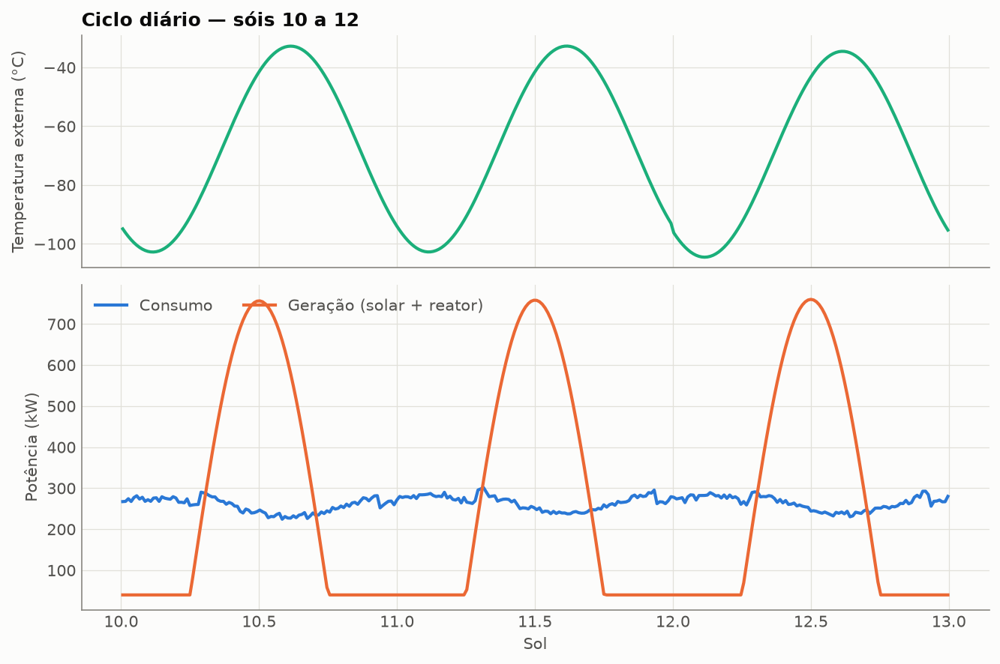
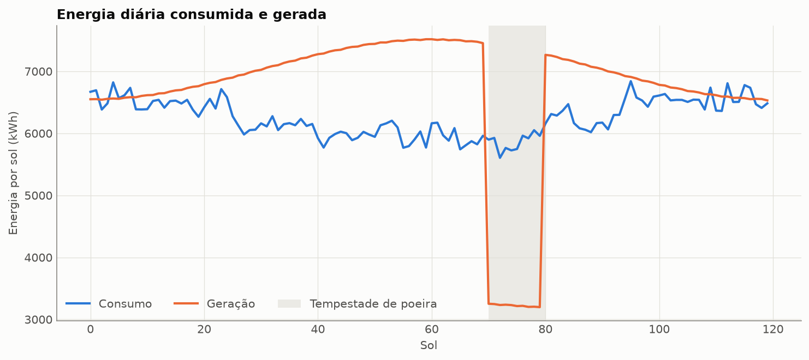
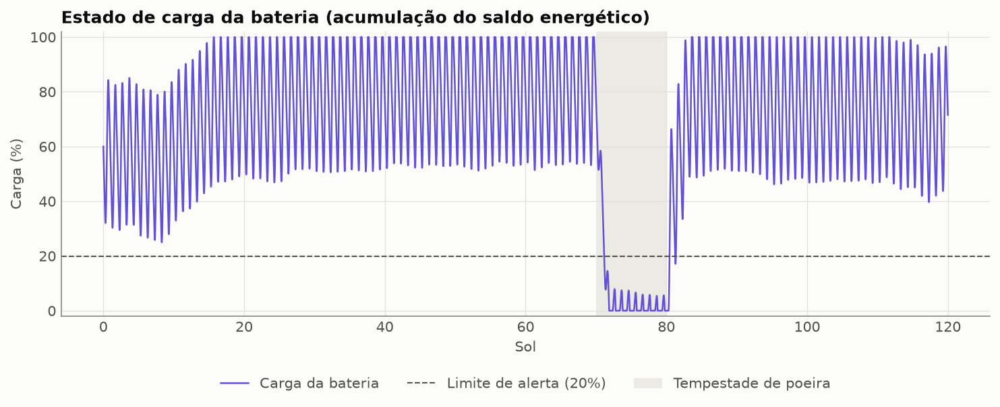
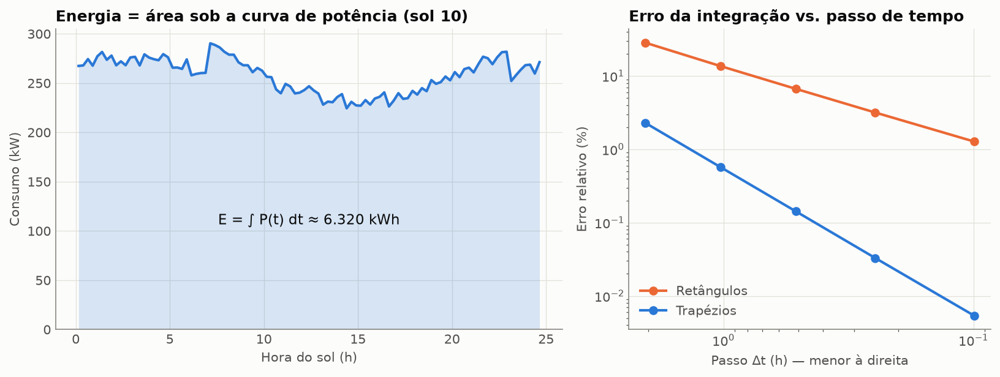
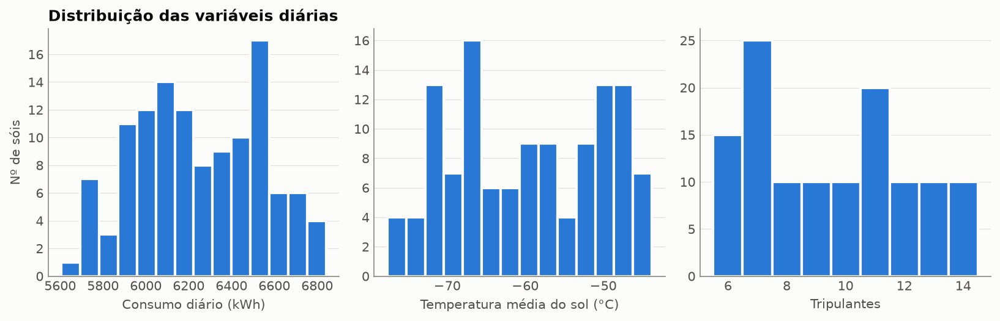
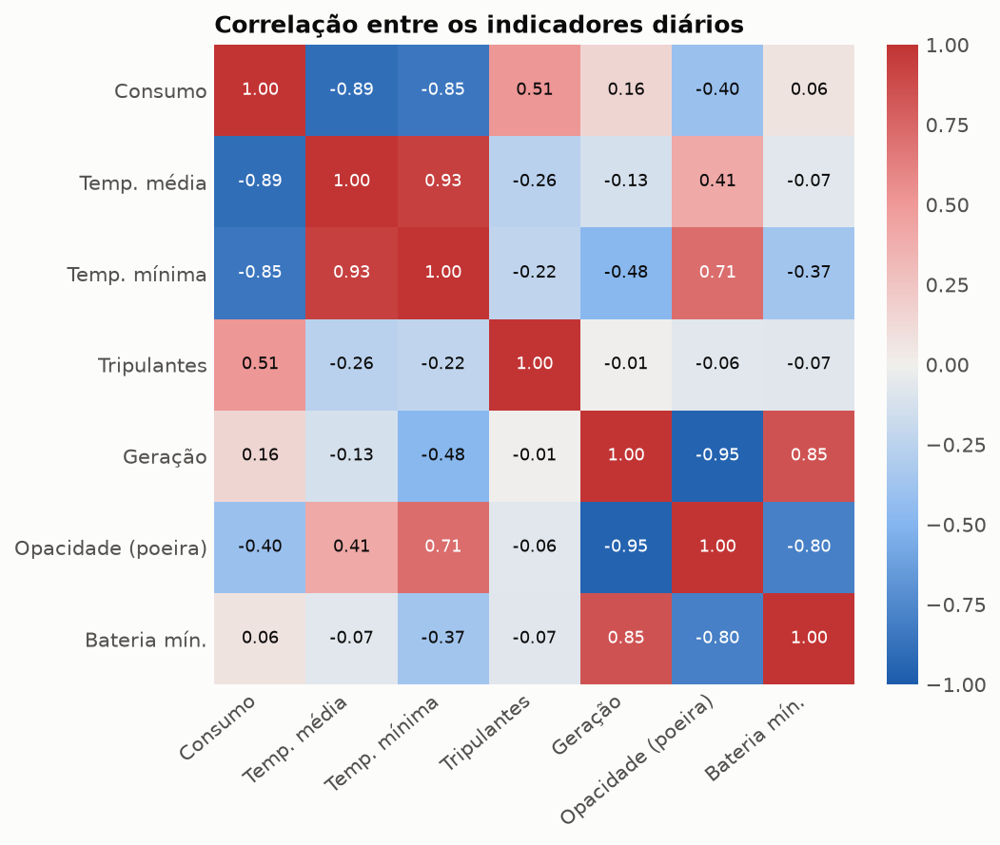
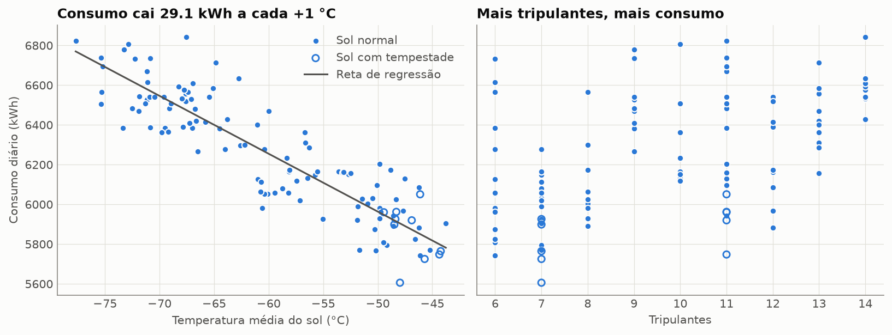
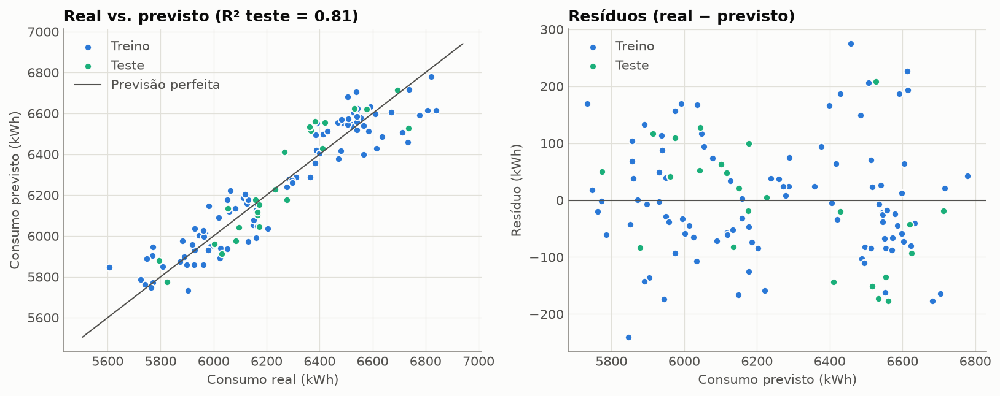
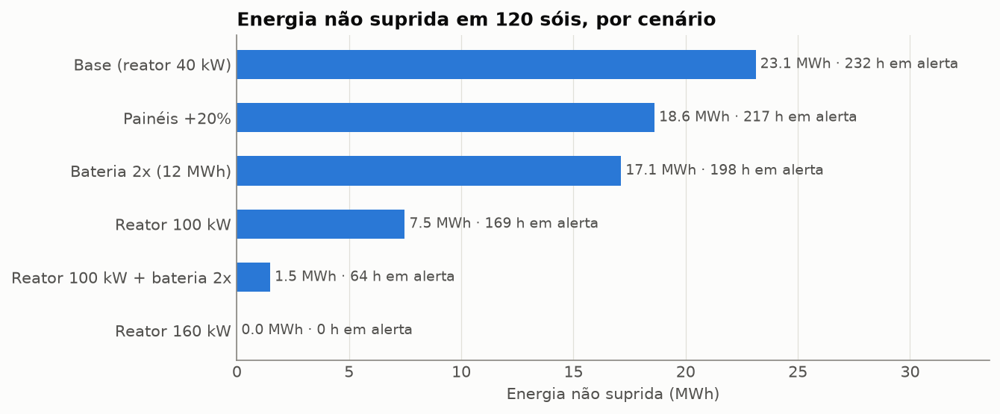

# Simulação e análise de dados — consumo de energia da colônia

> Parte da **equipe** (Matemática e previsão). Este documento resume o que foi feito,
> os resultados e como interpretá-los. Pode ser aproveitado diretamente no relatório técnico.

## Arquivos

| Arquivo | Conteúdo |
|---|---|
| `src/simulacao_energia.py` | Modelo da simulação e funções de integração numérica |
| `src/regressao_linear.py` | Regressão linear por mínimos quadrados, métricas e divisão treino/teste |
| `src/analise_simulacao.py` | Executa tudo: simulação, EDA, regressão, cenários, gráficos e exportação |
| `src/resultados_simulacao.py` | Funções para o menu do sistema principal (resumo, previsão, alerta) |
| `notebooks/simulacao_energia.ipynb` | Notebook narrado para apresentação (já executado) |
| `tests/test_simulacao.py` | 20 testes automatizados |
| `data/simulacao/*.csv`, `resultados_simulacao.json` | Dados gerados e resultados consolidados |
| `docs/graficos/*.png` | 9 gráficos |

Como executar (a partir da raiz do projeto):

```bash
python src/analise_simulacao.py          # gera dados, gráficos e JSON (~4 s)
python src/resultados_simulacao.py       # mostra o resumo como o menu do sistema mostraria
python -m pytest tests/test_simulacao.py # roda os testes
```

## 2.1 Fenômeno simulado

**Balanço energético da colônia ao longo de 120 sóis** (1 sol = 24,66 h), com passo de 15 minutos
(11.837 instantes). Em cada instante calculamos o consumo de cada módulo, a geração (painéis solares + reator)
e a energia armazenada na bateria. No meio do período ocorre uma **tempestade de poeira** (sóis 70–79).

Por que esse fenômeno: energia é o recurso que mantém todos os outros (aquecimento, suporte de vida, agricultura).
Saber **quando** e **por que** pode faltar energia é a decisão mais crítica da colônia.

## 2.2 Variáveis, hipóteses e dados de entrada

**Dados de entrada vindos do sistema principal:** os módulos de `data/dados_teste.json` (mesmos campos da tabela
`MODULOS`). `consumo_kwh` é usado como carga base (kW), `temperatura_c` como temperatura interna alvo e `status`
ajusta a carga (`MANUTENCAO` = 60%, `INATIVO` = 0%).

| Variável | Tipo | Valor usado |
|---|---|---|
| Temperatura externa | entrada | média −60 °C; ±12 °C sazonal; ±35 °C entre dia e noite; ruído de 3 °C por sol |
| Tripulantes | entrada | 6 a 14, sorteado a cada turno de 5 sóis |
| Tempestade de poeira | entrada | sóis 70–79; bloqueia 65% da luz; +5 °C e metade da amplitude térmica |
| Painéis solares | entrada | 7.000 m², eficiência 22%, irradiância de pico 500 W/m² |
| Reator de fissão | entrada | 40 kW constantes |
| Bateria | entrada | 6.000 kWh, começa com 60% |
| Consumo, geração, saldo | saída | kW por instante; kWh por sol |
| Estado de carga (SOC) | saída | 0–100% |
| Alerta de energia | saída (booleana) | `SOC < 20%` **OU** `energia não suprida > 0` |

**Hipóteses**
1. Aquecimento de cada módulo proporcional à diferença de temperatura: `0,35 kW/°C × (T_interna − T_externa)`.
2. Cada tripulante acordado (7h–23h) consome 2,5 kW no módulo habitacional.
3. Irradiância solar é uma meia senoide durante o dia; à noite, só o reator gera.
4. Bateria sem perdas; quando zera, a demanda que não pôde ser atendida é contabilizada como *energia não suprida*.
5. Ruídos aleatórios com **semente fixa** (42) — a simulação sempre gera os mesmos números.

Todos os valores são didáticos, em ordem de grandeza plausível, não dados reais de missão.

## 2.3 Simulação computacional

Implementada em Python com `numpy`/`pandas` (`simular()` em `src/simulacao_energia.py`). A temperatura, a
irradiância e a carga da tripulação são calculadas de forma vetorizada; a bateria é atualizada passo a passo,
porque cada estado depende do anterior e há limites (0 e capacidade).

**Resultados gerais (120 sóis)**

| Indicador | Valor |
|---|---|
| Consumo médio por sol | 6.248 kWh |
| Pico de potência | 314 kW |
| Energia consumida / gerada | 749,8 MWh / 802,1 MWh |
| Energia desperdiçada (bateria cheia) | 74,8 MWh |
| **Energia não suprida** | **23,1 MWh — na tempestade e no sol seguinte a ela** |
| Sóis com falta de energia | 10 |
| Horas em alerta | 231,8 h |
| Saldo médio na tempestade | −2.632 kWh/sol |

Leitura: a colônia gera **mais** energia do que consome no total, mas a energia não está disponível
**na hora certa** — sobra de dia (desperdício com bateria cheia) e falta na tempestade.





## 2.4 Conceito matemático: integração numérica e acumulação

Energia é a integral da potência no tempo: **E = ∫ P(t) dt**. Como a simulação só conhece P em instantes
discretos, usamos a **regra dos trapézios**, implementada manualmente:

```
E ≈ Σ (P[k] + P[k+1]) / 2 · Δt
```

A **acumulação** aparece na bateria: `E_bat(k+1) = E_bat(k) + ∫ (geração − consumo) dt` no intervalo, limitada entre 0
e a capacidade. O consumo acumulado (`consumo_acumulado_kwh`) também é uma integral acumulada.

**Validação do método.** A geração solar de manhã (do nascer ao meio-dia) é `P_max·sen(...)`, cuja integral exata é
`P_max · D / π = 3.022,07 kWh`. Comparando os métodos:

| Δt (h) | Trapézio (kWh) | Erro | Retângulos (kWh) | Erro |
|---|---|---|---|---|
| 2,06 | 2.952,71 | 2,30% | 2.161,53 | 28,48% |
| 1,03 | 3.004,79 | 0,57% | 2.609,20 | 13,66% |
| 0,51 | 3.017,75 | 0,14% | 2.819,96 | 6,69% |
| 0,25 | 3.021,07 | 0,03% | 2.926,13 | 3,17% |
| 0,10 | 3.021,90 | 0,01% | 2.983,62 | 1,27% |

Ao dividir Δt por 2, o erro do trapézio cai cerca de 4 vezes (método de **ordem 2**) e o dos retângulos cerca
de 2 vezes (**ordem 1**). Com o passo de 15 min usado na simulação, o erro é de ~0,03%.

> Observação: integrando o dia **inteiro**, os dois métodos dão o mesmo valor, porque a potência solar é zero nas
> duas extremidades — por isso a validação usa só a manhã.



## 2.5 e 2.6 Gráficos e análise exploratória

| Média por sol | Sóis normais | Sóis com tempestade |
|---|---|---|
| Consumo (kWh) | 6.284 | 5.856 |
| Geração (kWh) | 6.999 | 3.224 |
| Saldo (kWh) | +715 | −2.632 |
| SOC mínimo | 47% | 3% |
| Horas em alerta | 0,1 | 21,8 |

Correlação com o consumo diário: temperatura média **−0,89**, temperatura mínima −0,85, tripulantes **+0,51**,
opacidade −0,40.

**Achados**
- O consumo diário é estável (desvio-padrão de 297 kWh, ≈ 5%); quem varia muito é a **geração**.
- O frio é o principal fator do consumo (aquecimento); a tripulação é o segundo.
- Na tempestade o consumo até **cai** (a poeira retém calor), mas a geração cai muito mais.
- Fora da tempestade, o sistema está equilibrado: os únicos alertas aparecem nos sóis 80 e 81, logo depois dela,
  porque a bateria ainda está vazia na primeira noite (o sol 80 ainda tem 1,4 MWh de falta).




## 2.7 Regressão linear

**Indicador estimado:** consumo diário de energia (kWh).
**Modelo:** regressão linear múltipla, ajustada por mínimos quadrados (`b = (XᵀX)⁻¹Xᵀy`, via `numpy.linalg.lstsq`),
com 96 sóis de treino e 24 de teste (divisão aleatória com semente fixa).

```
consumo_kwh = 4321,3 − 26,67 · temp_media_c + 35,07 · tripulantes
```

| Coeficiente | Valor | Erro-padrão | IC 95% | Valor teórico* |
|---|---|---|---|---|
| Intercepto (b₀) | 4.321,3 | 70,5 | 4.183 a 4.460 | — |
| Temperatura (b₁) | −26,67 kWh/°C | 1,14 | −28,9 a −24,4 | −25,89 |
| Tripulantes (b₂) | +35,07 kWh/pessoa | 4,16 | 26,9 a 43,2 | +40,00 |

\* Derivado das hipóteses: b₁ = −3 módulos × 0,35 kW/°C × 24,66 h; b₂ = 2,5 kW × 16 h acordado.



## 2.8 Avaliação, interpretação e limitações

| Modelo | R² treino | R² teste | RMSE teste | Erro médio (MAPE) |
|---|---|---|---|---|
| Simples (só temperatura) | 0,81 | 0,72 | 125,0 kWh | 1,62% |
| **Múltiplo (temperatura + tripulantes)** | **0,89** | **0,81** | **103,4 kWh** | **1,38%** |

**Interpretação**
- **b₁ = −26,67:** cada 1 °C a mais na temperatura média reduz o consumo do sol em ~27 kWh. É o efeito do aquecimento.
- **b₂ = +35,07:** cada tripulante adicional aumenta o consumo em ~35 kWh por sol.
- **b₀:** só posiciona a reta; não tem leitura física (0 °C e nenhum tripulante estão fora dos dados).
- Os dois coeficientes teóricos estão **dentro do intervalo de 95%**: o modelo recuperou corretamente as
  relações que existem nos dados.
- Incluir os tripulantes melhorou o R² de teste (0,72 → 0,81) e corrigiu o coeficiente da temperatura
  (−29,1 no modelo simples), que estava distorcido por **variável omitida**.
- Os resíduos não mostram padrão em relação ao valor previsto, o que é compatível com uma relação linear.



**Limitações**
1. **Dados sintéticos:** o modelo aprende as hipóteses da própria simulação. Com sensores reais, as relações podem
   ser não lineares (isolamento, eficiência dos aquecedores variando com a temperatura etc.).
2. **Amostra pequena** (120 sóis) e **apenas uma tempestade** — pouca informação sobre eventos extremos.
3. **Faixa de validade:** −78 °C a −44 °C e 6 a 14 tripulantes. Fora disso é extrapolação (o menu avisa).
4. O modelo prevê **consumo**, não falta de energia — a falta depende também da geração, que não está no modelo.
5. Os sóis não são independentes (tripulação fixa por turno, estação do ano), o que torna os erros-padrão
   um pouco otimistas.

## 2.9 Apoio à decisão e integração com o sistema principal

A mesma simulação foi executada com alternativas de infraestrutura:

| Cenário | Energia não suprida | Sóis com falta | Horas em alerta |
|---|---|---|---|
| Base (reator 40 kW) | 23,1 MWh | 10 | 232 |
| Painéis +20% | 18,6 MWh | 9 | 217 |
| Bateria 2x (12 MWh) | 17,1 MWh | 7 | 198 |
| Reator 100 kW | 7,5 MWh | 7 | 169 |
| Reator 100 kW + bateria 2x | 1,5 MWh | 2 | 64 |
| Reator 160 kW | 0 | 0 | 0 |



**Recomendação:** mais painéis ou mais bateria ajudam pouco, porque a tempestade dura 10 sóis e corta a fonte solar.
O que resolve é uma fonte **independente do Sol**: um reator de 160 kW elimina a falta; 100 kW combinado com
bateria dupla reduz a falta em 94%. A escolha entre eles depende do custo, que não foi modelado.

**Como o sistema principal usa os resultados** (`src/resultados_simulacao.py`):

| Função | Uso no menu |
|---|---|
| `exibir_resumo_simulacao()` | Opção "Simulação energética": indicadores, equação do modelo, cenários |
| `menu_previsao_consumo()` | Pede temperatura e tripulantes e mostra o consumo previsto (± RMSE) |
| `estimar_consumo_diario(temp, tripulantes)` | Mesma previsão, para uso em código |
| `alerta_energia(soc, nao_suprida)` | Regra booleana `ALERTA = (SOC < 20%) OU (falta > 0)` |

Exemplo para o menu da equipe:

```python
from resultados_simulacao import exibir_resumo_simulacao, menu_previsao_consumo

case 7:
    exibir_resumo_simulacao()
case 8:
    menu_previsao_consumo()
```

**Para a equipe:** a regra booleana de alerta da simulação tem duas entradas — A = `SOC < 20%` e
B = `energia não suprida > 0` — e saída `ALERTA = A OR B` (tabela-verdade: só é falso quando A = 0 e B = 0).
Ela já está testada em `tests/test_simulacao.py::test_alerta_energia_tabela_verdade`.
